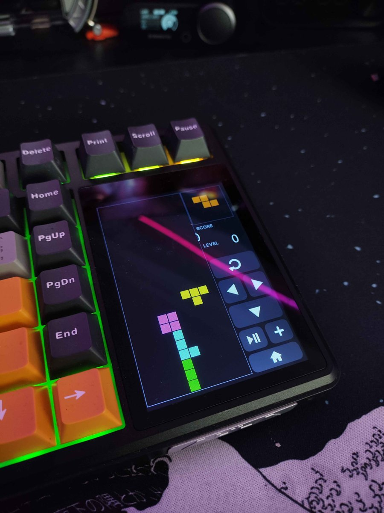
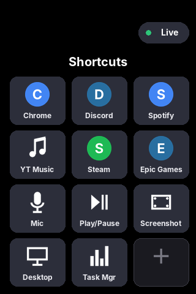

# AULA L99 screen mod

Extra apps for the touchscreen of the **AULA L99** keyboard:

- **Deck** – a Stream-Deck style page with 12 tiles. Each tile can launch a program, game or website, press a shortcut (F13–F24 included), toggle your mic, or control media. Set it up in a small editor on your PC, with real program icons.
- **Tetris** – the screen firmware already has a hidden Tetris game. This mod switches it on and gives it a home icon and touch controls (rotate, left/right, drop, pause, new game, score, level).
- **Live** – a page that shows live info from your PC: weather, what's playing (Spotify, YouTube Music, anything Windows sees as media), CPU/RAM, date and time.

  
  

> **Unofficial.** Not made or supported by AULA. Flashing the screen is at your own risk. Everything here was tested on one keyboard. You can always go back by flashing AULA's original screen updater (see [Going back](#going-back)).

**This repo contains no AULA files.** The installer takes AULA's own screen updater, which you download from AULA's website, checks it's the exact version this mod was made for, and builds the modded version on your PC.

---

## What you need

- An **AULA L99** and its **USB cable**. Flashing, and the Deck/Live PC features, work over the cable.
- **Windows 10/11.**
- **Python 3.10 or newer**: [python.org/downloads](https://www.python.org/downloads/). Tick **"Add python.exe to PATH"** while installing.
- AULA's screen updater: **`L99 reset firmware 2026.5.25.zip`** from AULA's support page:
  [aulastar.com → search "L99" → Firmware](https://www.aulastar.com/search.html?typeid=28&method=1&channelid=4&type=sonself&keywords=L99)

## 1. Build the modded updater

1. Download this repo: **Code → Download ZIP**, then unzip it.
2. Download `L99 reset firmware 2026.5.25.zip` from AULA. You don't need to unzip it.
3. **Drag the AULA zip onto `install.bat`.** If the zip is in your Downloads folder, double-clicking `install.bat` also finds it.

It unpacks AULA's screen updater, checks the screen file and creates a folder called **`L99-mod-updater`**. It refuses to continue if the file isn't the expected version, so a different AULA release can't get flashed by mistake.

## 2. Flash the screen

1. **Quit AULA's driver** (tray icon → Exit). It blocks the keyboard's serial port.
2. Connect the keyboard **with the USB cable** and switch it on.
3. Put the screen in **download mode**: hold **Fn + Space for about 5 seconds**. (AULA's own instructions: hold **Fn**, then press **X**, **0**, **6**.)
4. Open `L99-mod-updater\HFD_ISP_TOOL_V1.31.exe` and run the update. It's AULA's own update tool, used exactly as with AULA's updater. Wait until it says it's finished; writing the 127 MB screen file takes a while.
5. Leave download mode: hold **Fn + Space for about 5 seconds** again. If the screen doesn't come back, switch the keyboard off and on, then unplug and replug it.

The home screen now has two new icons in the last row: **Deck** and **Game**.

## 3. Set up the Deck on your PC

1. Double-click **`Deck Editor.bat`**. The first time, it installs the Python packages it needs.
2. Click a tile on the virtual screen and choose what it does: **Program** (pick from the Start menu or browse to an .exe/.lnk), **Website**, **Shortcut keys** or **Media**. The program's icon is used automatically, or pick your own.
3. Press **Save & send to keyboard**. This draws your tiles and sends the picture to the screen over USB. The screen freezes for a few seconds while it writes.
4. Tick **Start L99 Deck with Windows**, or press **Start L99 Deck now**.

The Deck program must be running for tiles to do anything. The Deck buttons send numpad keys. The program asks the screen which page is open: on the Deck page it runs your tile, and anywhere else the key passes through unchanged, so **Mini Numpad still works normally**.

**2.4 GHz / Bluetooth:** without the cable the PC can't ask the screen which page is open, so numpad keys always run Deck tiles. Add `"wireless": "numpad"` to `tools\deck.json` if you prefer them to stay numpad keys.

## Tetris

Open **Game** from the home screen; the game starts right away.

| Button | Action |
| --- | --- |
| ⟳ | rotate |
| ◀ ▶ | move left / right |
| ▼ | move down faster |
| ▶❚❚ | pause / continue |
| + | new game |
| ⌂ | back to home (resets the game) |

You get 10 points per line, and the speed goes up every 50 points (level 0–3).

## Live page

On the Deck page, press **Live** (top right). While the page is open, the running Deck program fills it every 2 seconds:

- **Weather**, from [Open-Meteo](https://open-meteo.com/), free with no account. Set your city in the Deck Editor.
- **Now playing**, from Windows' media controls, falling back to Spotify's window title.
- **System**: CPU and RAM load, date and time. You can customise these lines in `tools\deck.json`:
  `"live": {"city": "Berlin", "info": ["CPU %{cpu}  RAM %{ram}", "{date}", "{time}"]}`

The screen's fonts only have plain ASCII letters, so accents are dropped (é → e).

Bonus: `"version_text": "V1.04-MyBuild"` in `tools\deck.json` replaces the version shown under **Settings → About** while the Deck program runs. The keyboard writes its own firmware version there at boot.

## Going back

Flash AULA's original updater the same way: download mode, then run AULA's `L99 keyboard Screen reset firmware ... .exe`. That restores the stock screen.

## How it works

The screen is a Levetop UartTFT-II module with its own processor. It runs AULA's firmware and reads a 127 MB UI file that holds its pages, buttons and pictures. The mod only changes that **UI file**, never the firmware:

- It adds new pages (30 Deck, 31 Live) and fills page 24, which the firmware reserves for its built-in Tetris.
- It adds touch buttons and pictures in unused slots.
- It turns the game on: the firmware only enables it when the UI file's version number is odd. The mod changes it from 2.20 to 2.21 and re-signs the file's settings checksum.

The PC app talks to the screen over its USB serial port (`EEEF:268A`) to read the open page, write the Live text and upload the Deck picture.

All the details (file format, widget layouts, serial commands, firmware addresses) are in **[docs/TECHNICAL.md](docs/TECHNICAL.md)**.

## Files

| | |
| --- | --- |
| `install.bat` / `install.py` | builds `L99-mod-updater` from AULA's download |
| `Deck Editor.bat` | Deck editor (tiles, icons, city, send to keyboard) |
| `run-deck.bat` | runs the Deck program in a console window, handy for seeing errors |
| `tools/build_l99.py` | the UI file builder |
| `tools/l99_deck.py`, `l99_deck_gui.py`, `l99_live.py` | Deck program, editor, Live page |
| `tools/evb.py` | unpacks AULA's updater .exe (Enigma Virtual Box) |
| `tools/sim2.py` | renders pages of a built UI file, for checking without a keyboard |

## Credits

- Screen upload protocol groundwork: [gavindi/Aula_L99_Linux](https://github.com/gavindi/Aula_L99_Linux)
- Ideas and LT168B findings: [Salamor/aula-l99-open-widgets](https://github.com/Salamor/aula-l99-open-widgets)
- Weather: [Open-Meteo](https://open-meteo.com/)

## License

MIT for the code and pictures in this repo (see [LICENSE](LICENSE)). AULA's updater, firmware and UI file belong to AULA and are not included.
